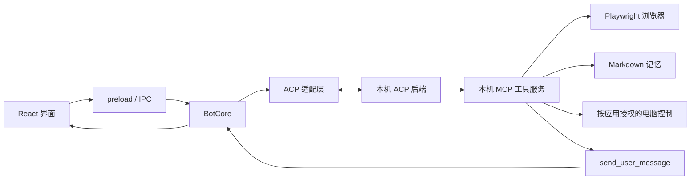

# Fenn Bot

本地运行的 ACP 桌面助手。把不同后端接成长期使用的 Bot，通过私聊或群聊协作；浏览器操作、过程记录、记忆和定时任务放在同一个应用里。

A local desktop messenger for ACP assistants, group collaboration and browser work. Built with Electron, React and Playwright. MIT licensed.


## Build and run

Requires Node.js 22 or newer and npm. Install Google Chrome to use the browser tools, and install/sign in to the ACP CLI backend you want to use.

```sh
git clone https://github.com/goldenfox2025/fenn-bot.git
cd fenn-bot
npm ci
npm run build
npm start
```

`npm run dev` starts development mode. Chrome is needed for the independent browser. ACP programs use their own sign-ins. Creating a session discovers models without sending a model prompt.

新建 Bot 后的欢迎语由所选后端生成，会发生一次模型调用；单独建立会话、读取模型列表不会发送模型提示。实际计费和可用模型由后端决定。

Fenn Bot is an independent local project. Backend adapters, memory, scheduling and basic UI primitives live in the checked-in `vendor/fenn` source snapshot; runtime assets live in `resources/fenn`. Building and testing require no Fenn Code checkout. Product behavior and screens remain in `src`.

To deliberately import selected updates, run `node scripts/sync-fenn.mjs <Fenn Code directory>` and review the resulting diff and `vendor/fenn/snapshot.json`. Normal commands never synchronize implicitly. The snapshot retains its MIT license. A clean checkout installs its own dependencies normally.

## Use

- Choose or create a Bot. Each has its own conversation, instructions, ACP session and browser tab.
- Create a group with several Bots; group actors keep their own context, activity and permissions, separate from private conversations.
- Open the input's “＋” menu to choose the backend/model before sending. The connection panel accepts additional ACP executables and argument arrays.
- Chat contains your messages and explicit Bot deliveries. Routine tool calls, reasoning and intermediate decisions appear only in operation records.
- Click the Bot title for its details, or open records from the progress link/input menu. Details, memory, computer evidence and permissions belong to the selected Bot.
- Add recurring work under Details. Tasks run only while this local app is running and wait for any required operation approval. Each Bot has its own memory; inspect, edit or delete it in Memory.

History/configuration is stored under `%APPDATA%/Fenn Bot/data` on Windows. `FENN_BOT_DATA` selects another profile. Requests still go through the chosen backend, which controls its own storage and network access.

## 技术方案

### 分层结构

| 部分 | 实现与职责 |
| --- | --- |
| 桌面宿主 | Electron：窗口、应用生命周期、本地进程和系统屏幕接口 |
| 界面 | React、TypeScript、CSS：聊天、群聊、详情、设置和响应式侧栏 |
| 进程桥接 | 隔离的 preload + IPC；渲染进程通过声明的 API 调用主进程，不开启 Node 集成 |
| 执行核心 | `src/main/Core.ts`：Bot 状态、ACP 会话、消息路由、工具组合、停止和持久化 |
| 后端适配 | `vendor/fenn/src/main/backends`：ACP JSON-RPC、程序发现、模型与配置选项、各 CLI 的协议差异 |
| 浏览器 | Playwright：本机 CDP 连接、独立无头 Chrome、按 Bot 管理后台标签页和页面证据 |
| 电脑控制 | Electron + 平台输入驱动：逐应用授权、窗口和焦点检查、屏幕证据及停止入口 |



后端使用兼容 ACP 的 CLI 或适配器，登录和模型服务由该程序提供。工具通过本机 MCP 端点接入；只支持 stdio MCP 的后端可通过附带的桥接进程使用同一套工具。Bot 没有独立的云端模型代理。

### 一条消息如何执行

1. 界面按对话保存草稿。发送后，核心分配 `runId`，建立该 Bot 的权限作用域和操作记录。
2. 准备或复用 ACP 会话，传入工作目录、长期指令、记忆和工具端点。换后端或长期指令会替换会话；模型和推理强度按 Bot、后端分别保留。
3. ACP 普通文本、思考和工具事件写入操作记录。只有调用 `send_user_message({ text, client_id? })` 才会生成 Bot 聊天气泡；`client_id` 可避免同一任务重复交付。
4. 工具执行前核对任务身份与授权。任务结束后记录完成、失败或取消状态。停止会撤销旧工具端点和权限，迟到的结果不能覆盖新任务。

消息交付和工作进展是两条独立的数据流。应用不会把任意进程输出冒充已经完成的回复。定时调度指令也进入操作记录，实际交付结果才进入聊天。

当前 ACP 会话保存在进程内。应用重启或会话替换后，会新建会话并回放最近 24 条聊天消息；操作记录不参与聊天回放。完整历史压缩和永久恢复后端会话还没有实现。

### 群聊与上下文隔离

群聊支持 2–8 个成员。每个成员既有原始 Bot 的 `identityId`，也有群内运行实例的独立 ID。群内实例使用自己的 ACP 会话、工作目录、记忆和操作记录，私聊历史不会自动放进群聊上下文。

未 `@` 时交给群的主 Bot。创建群时优先选参与其中的主 Fenn，否则选第一个成员；移除当前主 Bot 后由剩余第一个成员接替。界面提示与后端共用同一个选择函数。

`@` 精确匹配成员名称，含空格的名称使用 `@"Code Review"`。成员可用 `message_group_bot` 向同群另一成员提出具体任务。每个成员在一轮用户消息中最多参与一次，避免互相转发形成循环。回复附上实际发送成员。删除群聊保留成员 Bot 和私聊。

### 浏览器与权限

浏览器有自动发现、连接现有浏览器和独立无头 Chrome 三种方式。自动模式在没有可连接浏览器时使用独立浏览器；多个候选时询问用户。现有连接仅接受本机 CDP 地址，为 Bot 创建自己的后台标签页，不接管用户当前标签页。画面可在详情的「电脑」页中查看。

授权按 Bot、任务、网站来源和能力区分。普通读取、填写与非敏感按键可在任务内授权；点击、Enter 和敏感字段操作需要单独确认。单次许可不会变成长期许可，停止会撤销本轮授权。敏感输入不写入工具文本记录，但截图仍可能显示页面上的可见信息。

标签页和授权按 Bot 隔离；同一个浏览器 profile 的 Cookie 与登录态可共享。独立无头浏览器使用应用自己的 profile，不读取日常浏览器配置目录。

原生电脑操作默认关闭。开启后仍需按应用授权查看、点击或输入，并检查目标窗口与焦点。原生输入可能切换前台窗口，操作时提供停止栏与 `Ctrl+Shift+Esc`；macOS 还需要系统的录屏、辅助功能权限。

这些控制约束 Fenn 提供的工具和 ACP 权限请求，不能把任意后端 CLI 变成操作系统沙箱。后端自身拥有的文件、终端或网络能力仍由该程序管理。停止不能撤销已经在外部应用完成的操作。

### 记忆、调度和存储

记忆是带名称、摘要、类型和正文的 Markdown 文件。当前后端可以在工作中读写记忆，明确的“记住”请求有本地兜底；不会额外启动模型请求反复抽取。用户可以在详情中检查、修改或删除。

本地调度器支持指定时间、间隔、每日、工作日、每周和 cron。任务复用同一套 ACP 执行与权限机制，Bot 忙时延后，防止重复执行，记录上次结果和下次时间。任务只在 Fenn Bot 运行时执行，没有云端调度服务。

数据目录默认在 Electron 应用数据目录下的 `Fenn Bot/data`，可用 `FENN_BOT_DATA` 指定独立 profile。Windows 为 `%APPDATA%/Fenn Bot/data`，macOS 通常为 `~/Library/Application Support/Fenn Bot/data`。

| 位置 | 内容 |
| --- | --- |
| `state.json` | Bot、群聊、消息、操作记录、设置、模型偏好和任务；写入临时文件后替换 |
| `backends.json` | 用户添加的 ACP 程序路径与参数 |
| `bots/<运行实例 ID>/memory/` | 当前 Bot 或群内成员的 Markdown 记忆 |
| `workspaces/<运行实例 ID>/` | 后端工作目录 |
| `browser-profile/` | 应用独立浏览器的本地 profile |
| Electron 本地存储 | 当前对话、各对话草稿、侧栏宽度和节点书签 |

账号登录由后端 CLI 管理。不要把自己的运行数据或后端配置提交到源码仓库。桌面应用不能执行终端里的 shell 别名；添加后端时应填写实际程序路径，Node 脚本需要填写 Node 路径及脚本参数。

## Verification and current limits

```sh
npm run typecheck
npm test
npm run test:ui
```

`test:ui` 统一运行主流程、身份与群聊、生命周期、详情、布局和真实 CDP 浏览器连接测试。它使用临时数据目录、脚本化 ACP 后端、本地网页及无头 Chrome，隐藏 Electron 窗口，不调用付费模型，不向正常用户配置加入演示后端。运行前需要完成构建并安装 Chrome。

| 功能 | 验证路径 |
| --- | --- |
| Bot 与连接 | 创建、欢迎消息、头像颜色、改名、编辑指令、删除、自定义后端及参数校验 |
| 模型与强度 | 首条消息前读取、切换后端后恢复选择、重启保留 |
| 私聊与群聊 | 实际 ACP 交付、成员路由、`@`、成员调整、上下文隔离、搜索、删除及取消确认 |
| 执行生命周期 | 停止、过期权限、忽略取消的后端、迟到事件、失败后跨对话草稿恢复 |
| 记忆与调度 | 记忆增改删和隔离、任务管理、忙时延后、手动运行、失败记录、重启保留 |
| 浏览器 | 真实表单交互、读取与提交许可、截图证据、自有 CDP 标签页、多候选选择及自动回退 |
| 界面 | 深浅色、窄宽窗口、缩放、侧栏收放、键盘与焦点、长消息滚动、节点和书签 |

Windows 上进行了界面与浏览器验证，GitHub CI 检查源码类型、单元测试和构建。原生系统鼠标键盘注入、macOS/Linux 桌面行为、真实读屏软件及各商业后端账号的端到端行为仍需对应环境验证；脚本化 ACP 测试不能替代这些验证。目前没有打包安装器、云端同步和外部消息渠道。

See [ARCHITECTURE.md](ARCHITECTURE.md) for code ownership and [DESIGN.md](DESIGN.md) for the UI contract.

## License

[MIT](LICENSE). The selected Fenn Code modules retain their [original license](vendor/fenn/LICENSE); provider artwork attribution is retained in [the asset license](vendor/fenn/src/renderer/src/assets/providers/LICENSE.md). Backend CLIs are installed separately and have their own licenses and account terms.
