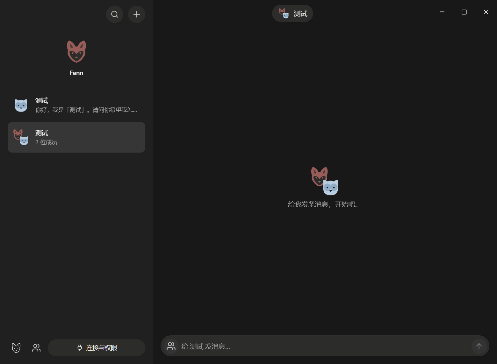

# Fenn Bot

一个实验性的 ACP 桌面聊天助手：长期存在的 Bot、群聊、浏览器操作、记忆和定时任务。源码按现状公开，暂不承诺持续维护；适合自己编译、研究或接着改。

A standalone desktop messenger for ACP assistants, with Playwright tools and explicit browser/application permissions. Released as an experimental source snapshot under the MIT license. There is no packaged release or active development roadmap.



## Build and run

Requires Node.js 22 or newer and npm. Install Google Chrome to use the browser tools, and install/sign in to the ACP CLI backend you want to use.

```sh
git clone https://github.com/goldenfox2025/fenn-bot.git
cd fenn-bot
npm ci
npm run build
npm start
```

`npm run dev` starts development mode. Chrome is needed for the independent browser. ACP programs use their own sign-ins. Creating a session discovers models without sending a model prompt.

Fenn Bot is an independent local project. Backend adapters, memory, scheduling and basic UI primitives live in the checked-in `vendor/fenn` source snapshot; runtime assets live in `resources/fenn`. Building and testing require no Fenn Code checkout. Product behavior and screens remain in `src`.

To deliberately import selected updates, run `node scripts/sync-fenn.mjs <Fenn Code directory>` and review the resulting diff and `vendor/fenn/snapshot.json`. Normal commands never synchronize implicitly. The snapshot retains its MIT license. A clean checkout installs its own dependencies normally.

## Use

- Choose or create a Bot. Each has its own conversation, instructions, ACP session and browser tab.
- Create a group with several Bots; group actors keep their own context, activity and permissions, separate from private conversations.
- Open the input's “＋” menu to choose the backend/model before sending. The connection panel accepts additional ACP executables and argument arrays.
- Chat contains your messages and explicit Bot deliveries. Routine tool calls, reasoning and intermediate decisions appear only in operation records.
- Click the Bot title for its details, or open records from the progress link/input menu. Details, memory, computer evidence and permissions belong to the selected Bot.
- Add recurring work under Details. Tasks run only while this local app is running and wait for any required operation approval. Each Bot has its own memory; inspect, edit or delete it in Memory.

History/configuration is stored under `%APPDATA%/Fenn Bot/data` on Windows. `FENN_BOT_DATA` selects another profile. Requests still go through the chosen backend, which controls its own storage and network access.

## ACP message contract

`send_user_message({ text, client_id? })` sends a complete Markdown chat message. Ordinary ACP response/reasoning chunks are stored as process records; they are not automatically forwarded into bubbles. `client_id` prevents a retried delivery from posting twice within the same task. Backends are instructed to use this tool for findings, questions and useful updates. Silence without a delivery is allowed; the host does not invent a chat reply from process output.

Both chat and operation journals persist locally. On session replacement only recent chat messages are replayed. Completed, failed, cancelled and unconfirmed tool states remain distinguishable in records.

## Permissions

Browser reading and ordinary fills/keys are scoped by Bot, origin and task. Clicks and Enter require individual approval because button labels cannot establish their actual effect. Password, one-time-code and card fields also require individual approval, with values concealed in the permission card and tool text traces. Page screenshots can still show visible form content. Filling a control may itself trigger site behavior; authorization is for the stated interaction.

The default browser has an independent profile. Existing-browser connections accept only local HTTP CDP addresses and create Bot-owned tabs. Changing connection mode closes owned resources.

Native application control starts disabled. The shared Fenn controller asks for per-application view/click/input tiers, checks the app under the pointer or in focus, and refuses this application's own windows. Grants are visible and revocable. Stop withdraws host permissions and detaches the task even if a CLI ignores cancellation. An operation already sent to an application cannot be undone by Stop.

These controls govern Fenn-provided tools and ACP permission requests. They do not isolate an arbitrary backend executable from the operating system.

## Verification and current limits

```sh
npm run typecheck
npm test
npm run test:ui
```

The UI suite uses an isolated scripted ACP process, real headless Chrome and a local HTTP form. It verifies denial, per-click approvals, image submit controls, actual submission, evidence, cancellation/stale results, model preparation, scrolling and layout. It does not call a paid model or ship a demonstration backend in normal builds.

Windows rendering and browser execution are exercised. Physical desktop input, native macOS behavior and a live screen-reader session have not been accepted. Session replacement replays up to 24 recent text messages; full history compaction and persistent ACP session recovery are not implemented. Scheduled tasks require the app to stay running. Packaged installers, cloud synchronization and messaging integrations are not provided.

See [ARCHITECTURE.md](ARCHITECTURE.md) for code ownership and [DESIGN.md](DESIGN.md) for the UI contract.

## License

[MIT](LICENSE). The selected Fenn Code modules retain their [original license](vendor/fenn/LICENSE); provider artwork attribution is retained in [the asset license](vendor/fenn/src/renderer/src/assets/providers/LICENSE.md). Backend CLIs are installed separately and have their own licenses and account terms.
